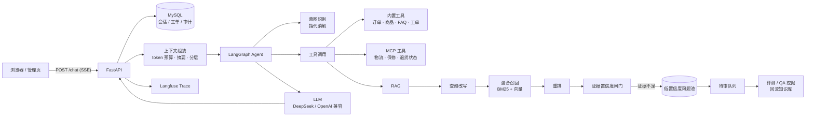

# 灯下 · 电商售后智能客服 Agent

**一个会查订单、讲政策，也敢说「没有依据」的售后客服 Agent。**

LangGraph 工作流 · 混合检索 RAG · 证据置信度闸门 · MCP 工具 · 数据飞轮


---

电商客服最容易出问题的地方，往往不是「不会聊」，而是：

- 问退货政策时**编造条款**；
- 问订单进度时**靠模型记忆瞎猜**；
- 聊到十几轮后**上下文爆炸**、开始答非所问；
- 答错了也**没人知道**，同样的问题下次继续错。

这个项目围绕这四个问题，从一个纯对话闭环开始，逐章加上工具调用、RAG、
Agent 工作流、意图识别、上下文管理、工具系统、可观测性与数据飞轮，最后用
一个独立的多标签主题分类器把问题池自动归类。

每一章都有对应的开发记录（`dev-notes/`），记录了设计取舍、失败尝试和验收证据。

## 核心设计

- **有证据才回答**：知识型问题先检索、再重排、再算证据置信度；证据不足时明确
  「无法确认」，并写入低置信度问题池，而不是让模型自由发挥。
- **业务数据走工具**：订单、商品、物流、保修、退货状态都通过工具/ MCP 获取，
  不依赖模型记忆；写操作有权限白名单、参数校验、超时重试与审计日志。
- **上下文可预算**：按模型窗口计算 token 预算，历史消息用「摘要 + 分层压缩」
  表示，长会话不会无脑塞满。
- **可运营的闭环**：低置信度问题进入待审队列，审核、评测、QA 挖掘再回流知识库，
  形成数据飞轮。

## 架构一览



一次请求的路径：

1. 前端通过 `POST /chat` 建立 SSE 流；
2. 读取会话历史，按 token 预算组装上下文（摘要、分层、最近窗口）；
3. LangGraph 识别意图、消解指代，决定直接回答还是调用工具；
4. 工具执行（内置 / MCP）或 RAG 检索（改写 → 混合召回 → 重排）；
5. 证据闸门判断是否足够回答，流式输出答案，同时写审计、Trace 和问题池。

## 功能地图

| 章节 | 能力 | 关键实现 |
|---|---|---|
| ch01 | 纯对话闭环，多轮消息落库 | FastAPI + SSE、MySQL 会话表 |
| ch02 | 工具调用 | 订单、商品、FAQ、工单四类工具 |
| ch03 | RAG 知识库 | Markdown 切分、embedding、Milvus FAQ 召回 |
| ch04 | RAG 进阶 | Dense / BM25 / Hybrid / Hybrid+Rerank 四策略，低置信度池 |
| ch05 | Agent 工作流 | LangGraph 状态机、步数与 token 预算、置信度闸门 |
| ch06 | 意图与对话管理 | 9 类意图、指代消解、订单选择中断 |
| ch07 | 上下文管理 | 分层压缩、滚动摘要、token 预算与降级 |
| ch08 | 工具系统 | ToolSpec 注册、读写权限、校验、超时重试、审计、MCP |
| ch09 | 可观测性与数据飞轮 | Langfuse、成本报表、待审队列、评测与 QA 挖掘 |
| ch10 | 多标签主题分类器 | 17 类主题、语料/合成/审核/训练/ONNX、独立推理服务 |

## 关键设计

### 证据置信度闸门

知识型问题并不会「检索到就回答」。混合召回和重排之后，系统会结合检索分数与
证据一致性计算置信度；低于阈值时回答固定拒答文案，并把问题与当时召回的片段
一起写入低置信度问题池。混合意图（既有知识问题又有业务操作）也有额外约束：
知识部分只能回答「无法确认」，业务事实照常返回。

### 上下文管理

应用不假设模型窗口无限大，而是从窗口大小反推预算：系统提示、输出、安全余量、
证据、摘要各自预留，剩余空间再分配给历史。历史消息不是原样堆积，而是
「最近窗口原文 + 较早消息半压缩 + 更早消息摘要」三层表示。

### 工具系统

所有工具统一注册为 `ToolSpec`，声明名称、参数、权限（读/写）和来源（内置/MCP）。
执行层负责参数校验、超时、重试、结果截断和审计；写工具必须在白名单内，
模型幻觉出的工具名不会落到数据库。审计日志记录每次调用的参数、结果摘要、
状态（成功/失败/超时/校验拦下/权限拒绝）。

### RAG 四策略

同一份知识库支持四种检索策略：纯向量、纯 BM25、混合（RRF）、混合后重排。
`/rag-eval` 页面可以并排对照结果；默认线上链路是混合 + 重排，并对失败做降级。

### 数据飞轮

低置信度问题 → 待审队列 → 人工审核/标注 → 评测集与 QA 挖掘 → 知识库更新。
批处理任务与主服务分离，按单进程设计，调度交给 Makefile / cron。

### 主题分类器（ch10）

17 类多标签分类（退换货、物流、尺码、发票、质量问题、运费、价保、支付……），
从语料构建、预标注、合成数据、人工审核、训练、阈值扫描到 ONNX 导出形成完整
流水线。训练环境独立（`.venv-ml`，Python 3.12），推理服务跑在 8110 端口，
不占用主服务的依赖。

## 技术栈

| 领域 | 技术 |
|---|---|
| Web | FastAPI、Uvicorn、Server-Sent Events |
| Agent | LangChain、LangGraph 1.2（SQLite checkpoint） |
| 模型 | DeepSeek（OpenAI 兼容协议，可切换其他兼容服务） |
| 存储 | MySQL 8、SQLAlchemy、PyMySQL |
| 检索 | Milvus 3.0、`BAAI/bge-m3`、`BAAI/bge-reranker-v2-m3` |
| 观测 | Langfuse v3、OpenTelemetry |
| 工具协议 | MCP 1.30（物流 / 售后两个本地 Server） |
| 分类器 | PyTorch、Transformers、ONNX Runtime（独立环境） |
| 前端 | 原生 HTML/JS/CSS；`frontend/` 保留旧版 React + Vite 组件 |

## 快速开始

### 前置条件

- Windows 10/11 + Git Bash（`start.bat` 需要 Git Bash 与 PowerShell）
- Python 3.13（ch10 分类器另需 Python 3.12）
- Docker Desktop（MySQL 8 + Milvus）
- 一个 OpenAI 兼容的 LLM API Key，以及 SiliconFlow embedding Key

### 1. 配置与安装

```bash
cp .env.example .env
# 至少填写 OPENAI_API_KEY / EMBEDDING_API_KEY

python -m venv .venv
.venv/Scripts/python.exe -m pip install -r requirements.txt
```

> `start.sh` 优先使用最新章节 worktree 的 `.venv`，没有才回退仓库根 `.venv`。
> 依赖请装在脚本实际使用的环境里（`./start.sh --print-target` 可查看）。

### 2. 启动依赖、初始化数据库与知识库（仅首次）

<details>
<summary>展开完整初始化命令</summary>

```bash
# MySQL 8 + Milvus（start.sh 也会自动做这一步）
docker compose up -d

# 表结构：幂等脚本
.venv/Scripts/python.exe -m app.db.init_ch03
.venv/Scripts/python.exe -m app.db.seed
.venv/Scripts/python.exe -m app.db.init_ch04

# ch05–ch08：一次性增量 DDL（ALTER / CREATE，不要重复执行）
docker exec -i cs_customer_mysql mysql -uroot -proot cs_customer < sql/ch05_low_confidence_source.sql
docker exec -i cs_customer_mysql mysql -uroot -proot cs_customer < sql/ch06_ticket_type.sql
docker exec -i cs_customer_mysql mysql -uroot -proot cs_customer < sql/ch07-ddl.sql
docker exec -i cs_customer_mysql mysql -uroot -proot cs_customer < sql/ch07-layers.sql
docker exec -i cs_customer_mysql mysql -uroot -proot cs_customer < sql/ch08-ddl.sql

# 表结构：幂等脚本
.venv/Scripts/python.exe -m app.db.init_ch09
.venv/Scripts/python.exe -m app.db.init_ch10

# 从 knowledge/ 构建知识库并向量化到 Milvus
.venv/Scripts/python.exe -m app.jobs.build_knowledge
```

</details>

### 3. 启动

双击 `start.bat`，或在 Git Bash 中：

```bash
./start.sh
```

脚本会自动选择最新的 `feature/chNN-*` 分支、准备 worktree、检查并拉起
MySQL / Milvus、清理 8000 端口、启动服务并打开浏览器。

常用开关：

| 变量 | 默认 | 说明 |
|---|---|---|
| `NO_BROWSER` | `0` | `1` 不自动打开浏览器 |
| `START_TIMEOUT` | `60` | 等待应用就绪的秒数 |
| `INFRA_TIMEOUT` | `180` | 等待 Docker / MySQL / Milvus 的秒数 |
| `INFRA_PORTS` | `3306 19530` | 启动前必须监听的端口 |
| `SKIP_INFRA_CHECK` | `0` | `1` 跳过依赖预检 |

也可以手动启动（需自行保证依赖已就绪）：

```bash
python run.py
```

## 体验入口

启动后访问 `http://127.0.0.1:8000/`：

| 路径 | 用途 |
|---|---|
| `/` | 客服聊天（会话上下文 + 订单选择 / 退款表单） |
| `/kb` | 知识库录入与重建 |
| `/rag-eval` | RAG 四策略并排评估 |
| `/review` | 低置信度问题待审队列 |
| `/topics` `/topics/questions` | 主题分布与类目问题 |
| `/acceptance` | 验收总览（数据 / 评测 / 错例） |
| `/observability` | 观测总览 |
| `/admin` | 后台首页 |

## 项目结构

```
app/
  api/         页面与 API 路由
  agent/       LangGraph 工作流、意图、指代消解、置信度
  rag/         切分、embedding、Milvus、重排、证据自检
  services/    聊天编排、历史/上下文、摘要
  tools/       工具注册与执行、内置工具、MCP、审计
  db/          模型、按章节 DDL 初始化、seed
  jobs/        知识构建、评估、成本、飞轮
  static/      管理页面
knowledge/     知识库 Markdown（商品 / 售后 / 退货 / FAQ）
sql/           各章节权威 DDL
mcp_servers/   物流（8101）与售后（8102）MCP Server
scripts/ch10/  分类器语料、训练、导出、评估
tests/         pytest + quickstart shell 测试
dev-notes/     每章开发记录
docs/          运维手册与设计文档
```

## 测试

```bash
# 默认使用仓库根 .venv
make test

# 依赖装在 worktree 的 venv 时，显式指定解释器
make PYTHON=.worktrees/<slug>/.venv/Scripts/python.exe test

# 等价于
<venv>/Scripts/python.exe -m pytest -q
```

当前测试套件共有 **1066 个 pytest 用例**（`pytest --collect-only` 统计），
覆盖工具执行、检索策略、上下文预算、提示词契约、API 与数据管道。

启动脚本另有 shell 测试：

```bash
bash tests/quickstart/test_start_sh.sh   # 13 passed
bash tests/quickstart/test_kill_tree.sh  # 3 passed
```

## 可选组件

<details>
<summary><b>MCP 物流 / 售后工具（ch08）</b></summary>

默认 `MCP_ENABLED=false`。启动两个本地 Server：

```bash
.venv/Scripts/python.exe -m mcp_servers.logistics_server    # 8101
.venv/Scripts/python.exe -m mcp_servers.aftersales_server   # 8102
```

再在 `.env` 中设置 `MCP_ENABLED=true` 并重启主服务。MCP 工具：
`query_logistics`、`query_warranty`、`query_return_status`。

</details>

<details>
<summary><b>Langfuse 可观测性（ch09）</b></summary>

```bash
make langfuse-up    # Web UI: http://localhost:3000
make langfuse-down
```

未启动时日志里的 `opentelemetry ... Failed to export spans` 属于噪音，不影响聊天。
详见 [`docs/ch09-operations.md`](docs/ch09-operations.md)。

</details>

<details>
<summary><b>主题分类器（ch10）</b></summary>

```bash
make ch10-env        # 创建 .venv-ml（Python 3.12）
make classifier-up   # 启动 8110 推理服务
make classifier-down
make ch10-eval       # 启动服务并跑评测
```

</details>

<details>
<summary><b>旧版 React 聊天组件</b></summary>

主页面由后端直接提供。`frontend/` 组件仍可单独开发：

```bash
cd frontend
npm install
npm run dev          # http://localhost:5173
```

</details>

## 常见问题

**回复「客服服务暂时不可用,请稍后重试」**

通常是依赖没启动：`/chat` 读取会话历史时连不上 MySQL。按顺序检查：

```bash
docker compose ps -a               # 容器是否 Exited
netstat -ano | grep ":3306 "       # 3306 是否监听
tail -n 50 <worktree>/log/app.log  # 查看 SQLAlchemy / pymysql 堆栈
```

重新运行 `start.sh` 会自动完成「启动 Docker → 拉起依赖 → 等待端口」。

**冷启动要多久？**

Docker Desktop + MySQL + Milvus 一般 30–60 秒。脚本会等到 3306/19530 就绪再
启动应用；Milvus 在端口打开后可能还需数秒才完全健康，稍等即可。

**`docker compose down` 会丢数据吗？**

不会，容器删除但数据卷保留；只有 `down -v` 才会删除数据卷。

## 文档

- [`dev-notes/`](dev-notes/)：ch01–ch10 每章的设计、实现与验收记录
- [`docs/ch09-operations.md`](docs/ch09-operations.md)：Langfuse、批处理与运维
- [`docs/superpowers/`](docs/superpowers/)：快捷启动脚本的设计与计划
- [`sql/`](sql/)：各章节权威 DDL

## 说明

- 知识库中的「灯下」店铺、商品与售后政策均为虚构示例数据。
- 运行需要自备 LLM 与 embedding API Key，相关费用由使用者承担。
- 本项目目前未声明开源许可证；如需复用或商用，请先联系作者。
